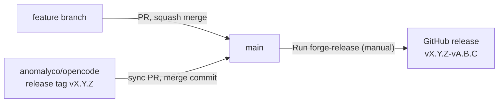

# Maintaining Forge

How changes land in Forge, how releases are cut, and how the fork stays in sync with upstream OpenCode.



Forge is built on OpenCode V2: the Effect server (`packages/core`, `packages/server`), the shared web app (`packages/app`) and the Electron desktop shell (`packages/desktop`). Forge's own work sits on top as ordinary commits, and upstream releases are merged in.

> **While the V2 port is in progress** (issue #60), Forge V2 lives on the `v2-port` branch, based on upstream `v2.2.5`. `main` still holds Forge V1. When the port is done, `v2-port` becomes `main` and V1 is kept under the `forge-v1-final` tag. Until then, read `main` below as `v2-port` for V2 work.

## Repository layout

| Path                                                 | What it is                                                                                                                                                      |
| ---------------------------------------------------- | --------------------------------------------------------------------------------------------------------------------------------------------------------------- |
| `packages/schema`                                    | Shared wire and storage contracts.                                                                                                                              |
| `packages/core`                                      | Sessions, tools, permissions, config, plugins and persistence.                                                                                                  |
| `packages/protocol`                                  | The public `HttpApi` definitions.                                                                                                                               |
| `packages/server`                                    | HTTP handlers and runtime composition.                                                                                                                          |
| `packages/client`                                    | Generated TypeScript clients. Regenerate with `bun run generate` there; never edit the generated files.                                                         |
| `packages/cli`                                       | The `opencode` command and background service. The server the desktop app runs is built from here.                                                              |
| `packages/app`, `packages/session-ui`, `packages/ui` | The web UI the desktop app renders.                                                                                                                             |
| `packages/gui-plugins`                               | Built-in UI plugins: session tabs such as Context and Details.                                                                                                  |
| `packages/desktop`                                   | The Electron app: Forge branding, window controls, the built-in browser, packaging.                                                                             |
| `packages/plugin-browser`                            | Upstream's browser tools. Forge only changes how their actions are shown.                                                                                       |
| `packages/tui`                                       | Kept only as an internal library for the ~138 files `packages/cli` imports. The full-screen TUI and its default command are removed; don't build features here. |
| `forge.json`                                         | Forge's own version.                                                                                                                                            |

Forge features live where their domain does, mostly as internal plugins registered in `packages/core/src/plugin/internal.ts` (for example `forge.plan` and `forge.memory`), so upstream merges touch as few shared files as possible.

## Branches and remotes

| Name              | What it is                                                                                                   |
| ----------------- | ------------------------------------------------------------------------------------------------------------ |
| `main` (origin)   | Forge's trunk. Every PR targets `main`, and every release is built from `main`.                              |
| feature branches  | Short-lived, branched from `main`, deleted after merge.                                                      |
| `upstream` remote | `git@github.com:anomalyco/opencode.git`. Read-only for us. Used to pull in new OpenCode releases.            |
| `dev` (origin)    | A leftover copy of upstream's `dev` from when the repo was forked. Don't target it, merge it, or push to it. |

Upstream's own docs and workflows assume the default branch is `dev`. That's true for upstream, not for Forge.

### One-time setup

1. **Point `gh` at the fork.** This checkout has two GitHub remotes, and `gh` may pick `anomalyco/opencode`. If it does, `gh pr create`, `gh workflow run` and `gh release` act on upstream instead of Forge. Pin it once:

   ```bash
   gh repo set-default divyanshusingh2903/forge
   ```

2. **Allow both squash merges and merge commits** (Settings → General → Pull Requests). Feature PRs use squash; upstream sync PRs need a merge commit.
3. **Turn on rerere locally** so Git remembers how you resolved a conflict and reapplies it at the next sync:

   ```bash
   git config rerere.enabled true
   ```

4. **Check the `upstream` remote exists** (`git remote -v`). If not:

   ```bash
   git remote add upstream git@github.com:anomalyco/opencode.git
   ```

## Making changes

1. **Branch from an up-to-date `main`.** Use a short hyphenated name of at most three words with no `feat/`-style prefix, e.g. `session-recovery` or `fix-scroll-state`.

   ```bash
   git switch main && git pull
   git switch -c fix-scroll-state
   ```

2. **Commit** with conventional messages: `type(scope): summary`, where type is one of `feat`, `fix`, `docs`, `chore`, `refactor`, `test`.
3. **Check it locally.** Upstream's `check` workflows run on Blacksmith runners this repo doesn't have, so no CI checks Forge PRs. The pre-push hook runs `bun run check` (lint and the full typecheck), and before opening the PR also run the tests of the packages you changed:

   ```bash
   bun run check                                       # from the repo root
   cd packages/<package-you-changed> && bun run test   # tests can't run from the root
   ```

   After changing `packages/protocol` or the server's `HttpApi`, run `bun run generate` in `packages/client` and commit the result. For UI or desktop changes, run the app (`bun run dev:desktop`) and click through what you changed.

4. **Open the PR against `main`**, titled like a conventional commit, and fill in the PR template:

   ```bash
   gh pr create --base main --title "fix(app): keep scroll position on tab switch"
   ```

5. **Squash and merge.** The PR title becomes the single commit on `main`. Delete the branch afterwards.

Merging a PR does **not** publish anything. `main` can collect several PRs before the next release.

## Versioning

Every Forge release has two versions joined together:

```
v2.2.5-v0.6.0
 └─┬─┘  └─┬─┘
OpenCode  Forge
```

- **OpenCode part** (`2.2.5`): the upstream release Forge is based on, read from the root `package.json`. It changes only when you sync from upstream. Never edit it by hand.
- **Forge part** (`0.6.0`): Forge's own version, stored in `forge.json`. It changes only when a release is run with a bump. It never resets when the OpenCode part changes.

Picking the Forge bump:

| Bump    | When                                                                                |
| ------- | ----------------------------------------------------------------------------------- |
| `patch` | Bug fixes and small tweaks.                                                         |
| `minor` | New features or behaviour changes.                                                  |
| `major` | Breaking changes, e.g. config or stored data that older builds can't read.          |
| `none`  | Nothing Forge-specific changed, e.g. a release that only picks up an upstream sync. |

To see the version the next release would get, without changing anything:

```bash
./script/forge-version.ts
```

The desktop app reports the combined version. The bundled server keeps reporting the plain OpenCode version, because the opencode.ai API checks it.

## Releasing

Releases are always started by hand. Nothing is published automatically when PRs merge.

**From GitHub:** Actions → **forge-release** → Run workflow → branch `main` → pick the bump.

**From the terminal:**

```bash
gh workflow run forge-release.yml --ref main -f bump=patch
```

The workflow (`.github/workflows/forge-release.yml`) runs three jobs:

1. **version**: bumps `forge.json` (unless the bump is `none`), commits `release: vX.Y.Z-vA.B.C` to `main`, pushes the tag, and creates a **draft** release with auto-generated notes. It fails straight away if that tag already exists.
2. **build**: on six runners (macOS arm64/x64, Windows x64/arm64, Linux x64/arm64), builds the server from `packages/cli`, then builds and packages the desktop app from `packages/desktop` and uploads the installers to the draft release.
3. **publish**: uploads the update manifests (`latest*.yml`, finalized by `packages/desktop/script/finalize-latest-yml.ts`), then publishes the release and marks it **Latest**.

The in-app updater for V2 is still being checked (issue #60), so until it is, users install new releases by hand.

Installers have version-free names (`forge-desktop-<os>-<arch>.<ext>`), so these links always point to the newest release:

```
https://github.com/divyanshusingh2903/forge/releases/latest/download/forge-desktop-mac-arm64.dmg
https://github.com/divyanshusingh2903/forge/releases/latest/download/forge-desktop-win-x64.exe
https://github.com/divyanshusingh2903/forge/releases/latest/download/forge-desktop-linux-x86_64.AppImage
```

### If a release fails

A failed run leaves a draft release and a pushed tag. The `forge.json` bump is already on `main`, so don't bump again:

1. Fix the problem on `main` through a normal PR.
2. Delete the draft and its tag:

   ```bash
   gh release delete v2.2.5-v0.7.0 --cleanup-tag --yes
   ```

3. Run the workflow again with bump **`none`**. It rebuilds the same version from the new `main`.

### Signing

Signing is optional, and the workflow turns it on automatically when the secrets exist:

- **macOS**: without `APPLE_CERTIFICATE` / `APPLE_CERTIFICATE_PASSWORD`, builds are ad-hoc signed and not notarized. Users have to right-click → Open, or allow the app in System Settings → Privacy & Security. Add `APPLE_API_KEY`, `APPLE_API_KEY_PATH` (the `.p8` contents) and `APPLE_API_ISSUER` to notarize as well.
- **Windows**: without the `AZURE_*` secrets, builds are unsigned and SmartScreen shows a warning on first run.

## Syncing with upstream

Merge upstream's latest **V2 release tag**, not its `dev` branch. `dev` changes constantly and may be mid-refactor. A release tag is something upstream actually shipped, and it moves the OpenCode part of Forge's version to a real OpenCode version. Upstream ships V2 releases often, so sync when a release brings something worth having or about once a month, not on every tag.

1. **Find the latest upstream release:**

   ```bash
   gh release view --repo anomalyco/opencode --json tagName -q .tagName   # e.g. v2.3.0
   ```

2. **Fetch it and branch from `main`:**

   ```bash
   git fetch upstream --tags
   git switch main && git pull
   git switch -c sync-v2.3.0
   ```

3. **Merge the tag:**

   ```bash
   git merge --no-ff v2.3.0 -m "chore: merge upstream opencode v2.3.0"
   ```

4. **Resolve conflicts.** Expect them wherever Forge has diverged:
   - **Rebranding**: `packages/desktop/` (icons, `electron-builder.config.ts`, `package.json`), the product name in `packages/ui/src/i18n` and `packages/app` strings, `README.md`, `NOTICE.md`, `CONTRIBUTING.md`. Keep Forge's side. OpenCode's own services (Go, Console, Free) keep their names.
   - **`packages/tui/`**: keep the full-screen TUI and its default command removed. Take upstream's changes to the files `packages/cli` still imports.
   - **Forge features**: permission modes and plan mode (`forge.plan`, the mode picker, plan dock and review tab), memory (`forge.memory`, `packages/core/src/memory*`), the git review panel, the Projects sidebar, Linux window controls, MCP dialogs, the context breakdown. Merge carefully; take upstream's changes where they don't undo Forge's behaviour.
   - **Config fields**: a Forge config key must stay in the `nativeAtomic` list in `packages/core/src/config/normalize.ts`, or normalization silently drops it.
   - **Generated client**: don't hand-merge `packages/client` generated files. Take either side, then run `bun run generate` in `packages/client`.
   - **`bun.lock`**: take upstream's copy, then regenerate it so Forge's own dependencies are added back:

     ```bash
     git checkout --theirs bun.lock && bun install
     ```

   - **Release pipeline**: check that upstream hasn't changed anything `forge-release` depends on: `packages/desktop/script/build.ts`, `packages/desktop/script/finalize-latest-yml.ts`, `packages/desktop/electron-builder.config.ts`, `packages/cli`'s build, `.github/actions/setup-bun`.
   - **Upstream workflows**: look at anything new or changed in `.github/workflows/`. Workflows guarded by `github.repository == 'anomalyco/opencode'` never run here. Unguarded ones do: today that is `check*.yml`, `bot-docs-locale.yml` and the `triage-*.yml` jobs, which close issues and PRs on a schedule once their branch is the default. Delete or guard those.

5. **Check it.** Confirm the new OpenCode version is picked up:

   ```bash
   bun install
   bun run check
   ./script/forge-version.ts   # the opencode= line should show the new version
   bun run dev:desktop         # smoke test: open a session, run a prompt, try plan mode and memory
   ```

   Run `bun run test` in the packages with the most conflicts, at least `packages/core`.

6. **Open the PR and merge it with a merge commit.** Never squash or rebase a sync PR: it would drop upstream's history, and Git would then treat all of those upstream commits as new again at the next sync, conflicting again.

   ```bash
   git push -u origin sync-v2.3.0
   gh pr create --base main --title "chore: merge upstream opencode v2.3.0"
   ```

7. **Release it.** Run `forge-release` with bump `none` if nothing Forge-specific is waiting to ship. If Forge PRs have merged since the last release, use the bump they call for.

### Sync checklist

- [ ] Latest upstream release tag found and merged on a `sync-vX.Y.Z` branch
- [ ] Conflicts resolved; full-screen TUI still removed; Forge branding intact
- [ ] Client regenerated, `bun.lock` regenerated, `bun run check` passes, desktop app smoke-tested
- [ ] New or changed upstream workflows checked
- [ ] Sync PR merged into `main` with a **merge commit**
- [ ] `forge-release` run, release published and marked Latest
